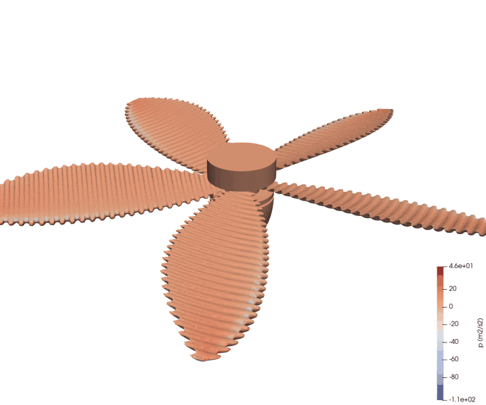
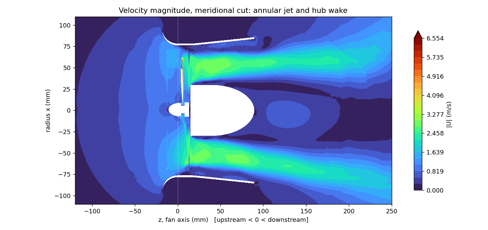
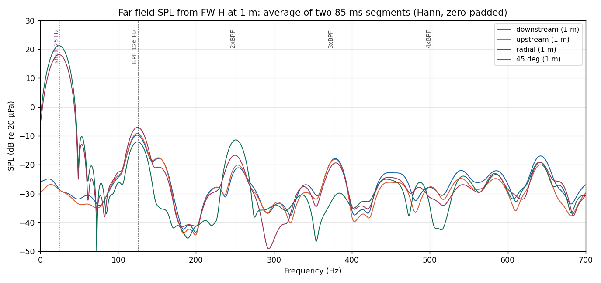
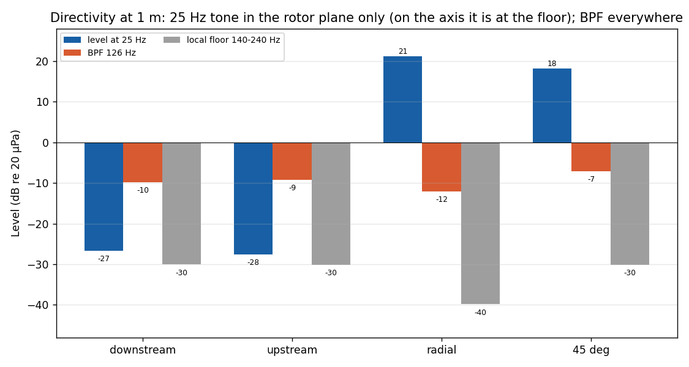
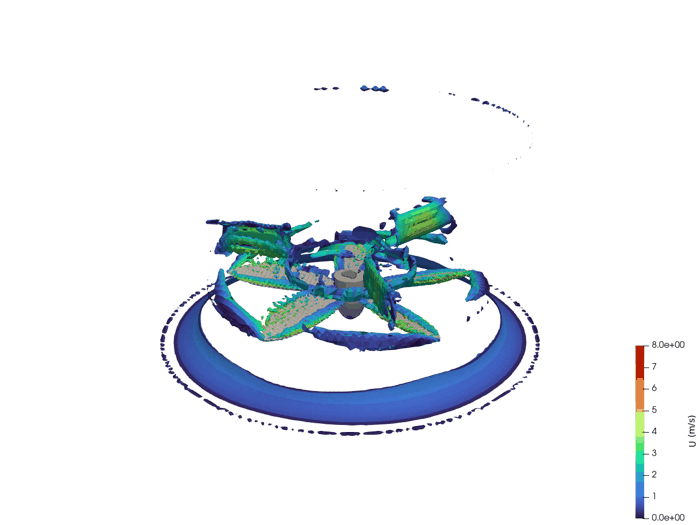
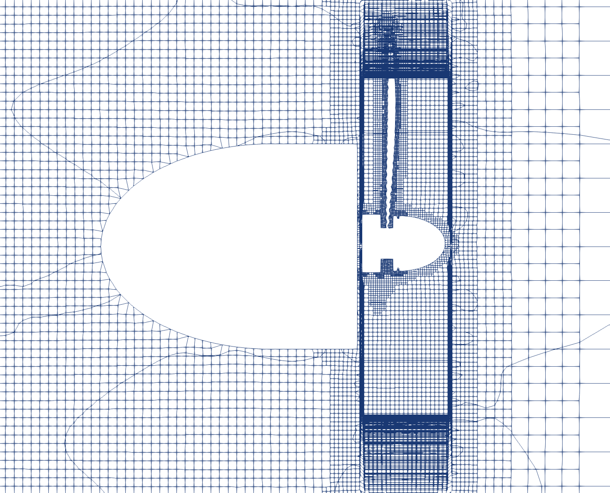
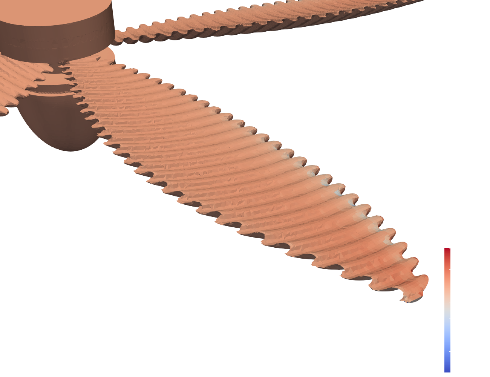
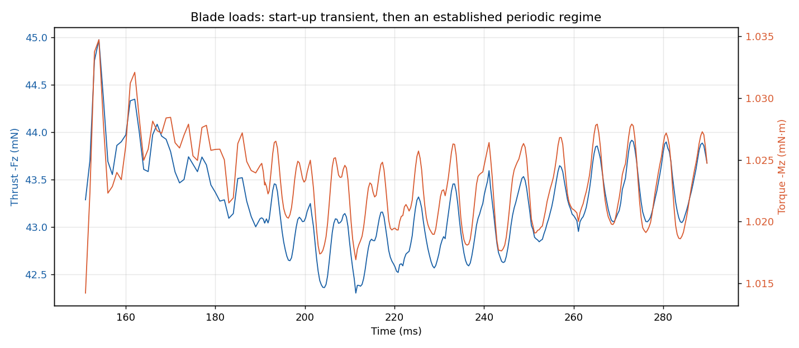
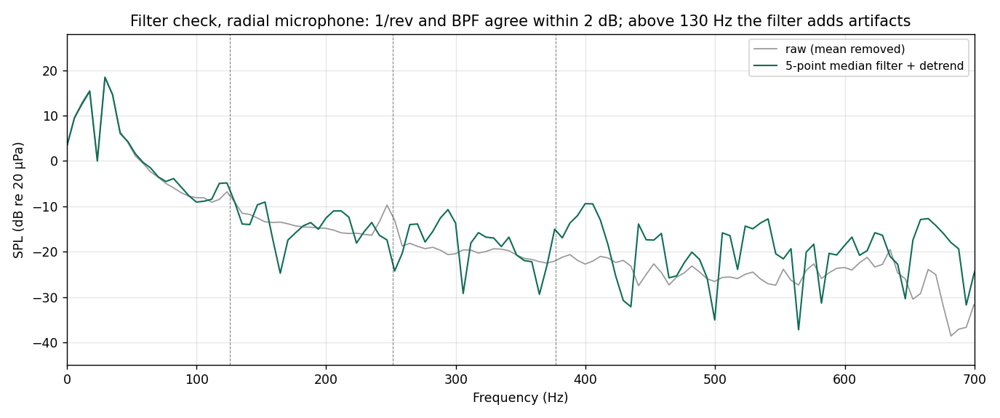

# Aeroacoustic CFD of a ducted fan with owl-inspired serrated blades

URANS simulation (OpenFOAM, k-ω SST, sliding mesh) of a 5-blade ducted desk fan at 1509 rpm, coupled to a Ffowcs Williams–Hawkings analogy to predict the tonal noise at 1 m: 43 mN of thrust, 108 m³/h, and a blade-passing tone at 126 Hz.

<p align="center">
  <br>
  <em>Five serrated blades, coloured by surface pressure (kinematic, m²/s²).</em>
</p>

Polytechnia is the engineering consultancy I co-founded in 2026. One of its first projects was a quiet desk fan whose blades carry trailing-edge serrations inspired by owl feathers (Wei et al., *Nature Communications*, 2024). Between late May and June 2026, starting from the Polytechnia FreeCAD model, I built the simulation chain to see what such a fan sounds like before printing it: STL export and checks, mesh, rotating URANS, acoustic analogy, spectra. This was internal Polytechnia work; no client has received it. The structural side of the same fan (modal and drop-shock analysis of the 3D-printed housing) is in [ventilator-modal-analysis-petgcf](https://github.com/clementdumeril/ventilator-modal-analysis-petgcf).

Skills: OpenFOAM case set-up and debugging (sliding mesh, solver stability), signal processing (FFT, windowing, spike filtering checked against raw), Linux/MPI cluster built and benchmarked, Python/pvpython pipelines.

Full report, in preprint form: [`paper/main.pdf`](paper/main.pdf).

## Results

| Quantity (established regime, ω = 158 rad/s) | Value | Source |
|---|---:|---|
| Axial thrust / torque | 43.3 mN / 1.02 mN·m | [`perf_aero.py`](postprocessing/aero/perf_aero.py), [`data/forces_data`](data/forces_data) |
| Aerodynamic power (torque × ω) | 0.162 W | same |
| Volume flow rate, 60 mm downstream | 108 m³/h (30 L/s) | integrated on the downstream cut; needs the unpublished ParaView slices |
| Blade-passing tone (BPF = 5 × 25.15 Hz) | 126 Hz, 20 to 28 dB above the local floor on all four microphones, with harmonics at 252 and 378 Hz | [`post_acoustique_combine.py`](postprocessing/acoustics/post_acoustique_combine.py), [`data/`](data) |
| Strongest tone | 25 Hz (once per revolution), in the rotor plane only: more than 45 dB above its level on the axis, where it stays at the floor | same |

<p align="center">
  <br>
  <em>Meridional cut: the blades drive an annular jet along the duct wall, with a slow recirculating wake behind the motor hub.</em>
</p>

<p align="center">
  <br>
  <em>FW-H spectra relative to each microphone's floor: two 85 ms records (15 ms start-up removed from each), one Hann-windowed spectrum per record, averaged. The BPF and its second harmonic appear on every microphone, the third on all but the radial one; the 25 Hz tone only in the rotor plane. Shaded: a comb of lines spaced 100.5 Hz, probably numerical (see below).</em>
</p>

The 25 Hz tone was not expected for a 5-blade rotor. The force history explains it: the in-plane blade force (0.95 mN, of which 0.77 mN from pressure) rotates with the rotor and oscillates at the shaft frequency, while the thrust fluctuates near the BPF. A rotating in-plane force radiates mostly in the rotor plane, which matches the 25 Hz tone being 3 dB weaker at 45° than at the radial microphone, with nothing above the floor on the axis. The tone has the same level and phase in both records, so it is a steady feature of the run. At 25 Hz the rotor is acoustically compact, and a compact dipole rotating in the rotor plane radiates nothing on the axis and 3.0 dB less at 45° than in the plane; the FW-H data give 3.1 dB. I have not established whether that imbalance comes from the STL and mesh (the surfaces are faceted) or from the flow. A perfectly symmetric rotor with three arms would not radiate the BPF on the axis either (the axisymmetric mode first appears at 3×BPF), so the on-axis BPF also points to a loss of five-fold symmetry.

Above 600 Hz the spectra contain lines every 100.5 Hz (642 to 1446 Hz), up to 44 dB above the floor. They come from bursts in the blade force whose period, fitted on ten bursts, is 9.943 ± 0.011 ms: a quarter revolution, and not the 10 ms field write interval. The comb is locked to the rotor four times per revolution, probably through the four-fold symmetry of the box and Cartesian mesh seen across the AMI interface; I treat it as numerical and leave it out of the results ([`paper/scripts/comb_check.py`](paper/scripts/comb_check.py)).

<p align="center">
  <br>
  <em>Absolute levels are unreliable (see the force-based check below); compare levels between microphones only.</em>
</p>

## What I built

- Geometry: exported the casing, rotor, hub and motor from the Polytechnia FreeCAD assembly to STL with Python scripts, and checked the tip clearance and duct bore on the exported surfaces.
- Mesh ([`snappyHexMeshDict`](openfoam_case/system/snappyHexMeshDict)): hex-dominant snappyHexMesh, 10 mm background cells refined to 0.31 mm on the blades (level 5) so that the serrations are resolved, with refined rotor and wake cylinders. Final mesh: 1.95 M cells, max non-orthogonality 61. An earlier 0.91 M-cell mesh (blades at level 4) ran locally under WSL and is not used; its dictionary is kept as `snappyHexMeshDict.baseline_0p91M`.
- Sliding interface ([`createBafflesDict`](openfoam_case/system/createBafflesDict)): a cylindrical faceZone (R = 72 mm) around the rotor, split into a cyclicAMI pair with `createBaffles`, about 35 k faces interpolated at each step.
- Flow model ([`openfoam_case/`](openfoam_case)): `pimpleFoam`, k-ω SST, solid-body rotation at 158 rad/s with a 5 ms start-up ramp. Phase 1 ([`controlDict`](openfoam_case/system/controlDict)) runs to 0.19 s with an adaptive Δt (`maxCo 3.0`, `maxDeltaT 1e-4`) until the loads settle; phase 2 ([`controlDict.phase2`](openfoam_case/system/controlDict.phase2)) restarts with a fixed Δt = 3.5·10⁻⁵ s so the FW-H signal is uniformly sampled.
- Acoustics ([`fwhControl`](openfoam_case/system/fwhControl)): Farassat formulation 1A (libAcoustics) on the rotating blade surface, four observers at 1 m: downstream, upstream, radial and 45°.
- Post-processing ([`postprocessing/`](postprocessing)): Python for the spectra, loads and flow rate; pvpython for the 3-D renders and animations.
- Compute: a 2-node Linux cluster I set up for this project and for the Code_Aster runs (8 + 4 cores, MPI over Ethernet, shared NFS case directory).

<details>
<summary>How I got to this setup</summary>

I started at the end of May with steady MRF runs (3000, then 4320 rpm) to get flow rates quickly. For the transient run I first tried the non-conformal coupling (NCC) of OpenFOAM.org. Over six mesh variants (re-ordered interfaces, Delaunay caps, rounded caps) the runs kept stopping in `fvMeshStitcher` around 200 µs of simulated time, so on 12 June I moved to the ESI OpenFOAM and cyclicAMI. The other practical fixes are listed in [`docs/METHODOLOGY.md`](docs/METHODOLOGY.md#6-practical-pitfalls-solved-lessons-learned): serial snappyHexMesh (the parallel run aborted on the AMI zone) and PCG instead of GAMG for the pressure on the coarse mesh.

</details>

## How it works

Tonal fan noise comes from the unsteady pressure the blades exert on the air, a rotating dipole. The domain is only 0.4 m wide and the solver is incompressible, so it carries no sound waves. FW-H solves this: the pressure on the blade surface is recorded during the run, and the wave equation is integrated analytically to each microphone at its retarded time.

```
FreeCAD → STL → snappyHexMesh + cyclicAMI → pimpleFoam k-ω SST → FW-H (blade surface) → p'(t) at 4 mics → FFT
```

<p align="center">
  <br>
  <em>Q-criterion vortices shed by the rotating blades, coloured by velocity: tip vortices and the helical wake.</em>
</p>

<p align="center">
  
  <br>
  <em>Left: mesh refinement from the far field to the blade band and AMI cylinder. Right: the serrated trailing edges as resolved by the mesh.</em>
</p>

## How I checked it

- Established regime. Thrust varies by less than 1 % per revolution after about 4.75 revolutions, before FW-H recording starts.

  

- Results recomputed from `data/`: `perf_aero.py` and `post_acoustique_combine.py` recompute thrust, torque and tone levels from the files in [`data/`](data). The values in the Results table come from those runs; the flow rate needs the ParaView slices, which are not published.
- Spectrum processing: the two FW-H records are 85 ms each once their start-up is removed, with a 15 ms gap between them. My first version concatenated them, which puts a 136° phase jump into the 25 Hz component, and applied a 5-point median filter against numerical spikes. Neither held up: the few outlier samples in the segments do not need filtering (the large values on the axial microphones are in the discarded start-up), and the filter raised the floor by 9 to 24 dB and hid the BPF harmonics. The spectra are now computed per record and averaged, on the raw signal. The 25 Hz tone has the same level and phase in both records on the radial microphones.

  

- FW-H output against the blade forces ([`paper/scripts/dipole_check.py`](paper/scripts/dipole_check.py)): at 0 Hz, 25 Hz and the BPF the rotor is acoustically compact, so the FW-H signal should match a dipole built from the integrated blade pressure force. The directivities match (the mean signal follows cos θ, the 25 Hz tone is empty on the axis and 3 dB lower at 45°). The amplitudes do not: −9 dB for the mean load, +14 dB at 25 Hz, −18 dB for the BPF on the axis. The mean-load case has no time derivative and no retardation, so the first suspect is the input to the acoustic step (pressure scaling, normals or the library output convention). The results are therefore the tone frequencies and directivities; the levels are not.
- Mesh quality: `checkMesh` figures and the cells the solver has to tolerate are listed in [`docs/METHODOLOGY.md`](docs/METHODOLOGY.md#3-mesh); their effect on the spectrum has not been measured.
<details>
<summary>Cluster benchmark</summary>

On a 0.78 M-cell test case, the gain on one node saturates at 4 cores (1.51× over 1 core, 1.44× on 8). 12 cores across both machines reached 1.93×, at 16 % parallel efficiency. For this AMI case, splitting one run across the two machines gave no gain, so I used the cluster to run independent cases side by side.

</details>

## Limitations

- No mesh-independence study: one 1.95 M-cell mesh was retained, not validated against coarser and finer meshes.
- No prism layers on the blades (not used in the retained mesh; an earlier attempt collapsed on the thin serrated edges). Blade y⁺ averages about 4 and peaks at 445, so the surface loading is preliminary.
- Time-step independence was not checked with a second Δt.
- URANS resolves tonal noise only. Serrations act mainly on broadband noise, and there is no smooth-blade reference run, so this study does not measure the effect of the serrations.
- The FW-H surface covers the blades only (no casing, arms, hub or quadrupole terms), and absolute levels are not compared with any measurement. They are also inconsistent with the blade forces (see above), a discrepancy I have not resolved.
- Two 85 ms records give an 11.8 Hz resolution. A contiguous 0.4 s record would take more than 100 h on the 1.95 M-cell mesh (16.5 s per step was measured on the 0.91 M-cell mesh), and the cluster holding the restart data was offline in October 2026.
- The solver runs only with floating-point trapping off (`FOAM_SIGFPE=false`) because of degenerate cells; their effect was not measured. Time integration is first order (227 steps per BPF period), and the lateral boundaries are 2.6 duct radii from the axis.

## Reproduce

The mesh and solver steps need the STL geometry (`constant/triSurface/{helice,carter,moteur,bras}.stl`), which is not published. Post-processing runs from the files in `data/`.

Post-processing, from the repository root (Python 3 with numpy, scipy, matplotlib; vtk for the flow figures; a few seconds each):

```bash
python postprocessing/acoustics/post_acoustique_combine.py      # spectra, tone levels, directivity, filter check
python postprocessing/aero/perf_aero.py                         # thrust, torque, power (+ flow rate if the slices are given)
python postprocessing/rendering/render_flow_2d.py <flow_vtk>    # needs meridien.vtp and avalZ.vtp exported from ParaView (not published)
```

Solver, with OpenFOAM (ESI; the published records come from the cluster runs, v2506) and [libAcoustics](https://github.com/unicfdlab/libAcoustics), once the STL files are in place:

```bash
cd openfoam_case
cp -r 0.orig 0
blockMesh && surfaceFeatureExtract
snappyHexMesh -overwrite          # serial: the parallel run aborts on the AMI faceZone
createBaffles -overwrite          # builds the cyclicAMI pair
decomposePar
export FOAM_SIGFPE=false          # the solver aborts at step 1 on degenerate cells otherwise (docs/METHODOLOGY.md, §6)
mpirun -np 8 pimpleFoam -parallel                    # phase 1, to 0.19 s
cp system/controlDict.phase2 system/controlDict
mpirun -np 8 pimpleFoam -parallel                    # phase 2, FW-H recording to 0.39 s
```

The full report is [`paper/main.pdf`](paper/main.pdf) (rebuild with `paper/build_paper.sh`). The June 2026 reports, which predate the re-analysis, are kept in [`docs/archive/`](docs/archive).

## Credits

- Serration concept and acoustic method: Z. Wei et al., *Towards silent and efficient flight by combining bioinspired owl feather serrations with cicada wing geometry*, Nature Communications, 2024 (G. X. Gu group, UC Berkeley).
- FW-H implementation: [libAcoustics](https://github.com/unicfdlab/libAcoustics). Solver: OpenFOAM (ESI). The published records come from the cluster runs, whose scripts source v2506; the earlier 0.91 M-cell run under WSL used v2406 and is not used. The cluster has been offline since June, so this could not be re-checked from the case directories.
- Fan geometry: Polytechnia FreeCAD model. Simulation setup, runs, post-processing and reports: Clément Dumeril.

[clement.dumeril.net](https://clement.dumeril.net) · [github.com/clementdumeril](https://github.com/clementdumeril) · MIT licence
