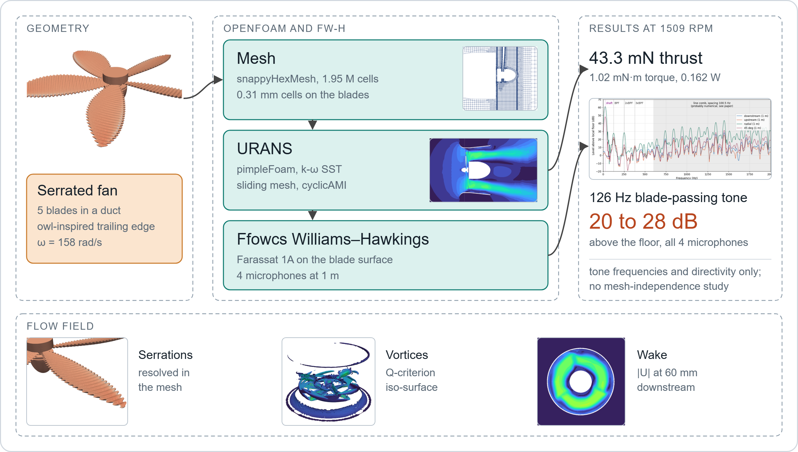
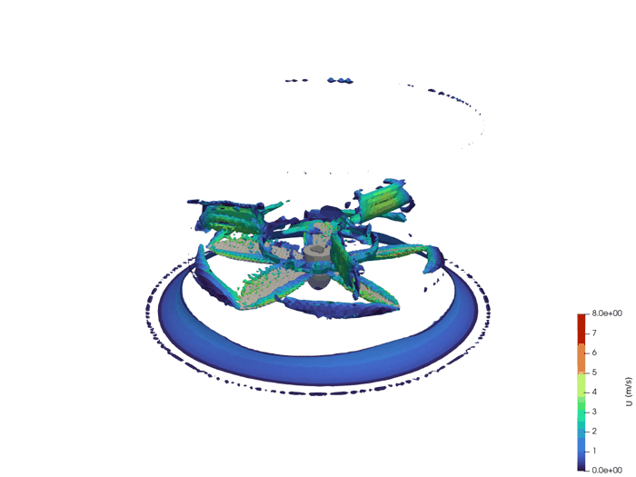

# Ducted-fan aeroacoustics: URANS and FW-H prediction of a serrated desk fan

[Report (PDF)](paper/main.pdf) · [Details](docs/details.md) · [Methodology](docs/METHODOLOGY.md) · [OpenFOAM case](openfoam_case/) · [Housing structure of the same fan](https://github.com/clementdumeril/ventilator-modal-analysis-petgcf) · [Cite](CITATION.cff)



A sliding-mesh URANS simulation (OpenFOAM, k-ω SST) of a 5-blade ducted desk fan with owl-inspired serrated blades, coupled to a Ffowcs Williams–Hawkings analogy, gives 43.3 mN of thrust at 1509 rpm and resolves the 126 Hz blade-passing tone 20 to 28 dB above the spectral floor at four microphones 1 m away. Absolute levels disagree with a dipole estimate, so only tone frequencies and directivity are used.

## Method

The FreeCAD model is meshed with snappyHexMesh (1.95 M cells, 0.31 mm on the blades so the serrations are resolved). The rotor zone turns at 158 rad/s and is coupled to the stator through a cyclicAMI interface; `pimpleFoam` solves incompressible URANS with k-ω SST, first with adaptive Δt, then with a fixed Δt = 3.5·10⁻⁵ s so the acoustic signal is uniformly sampled. libAcoustics evaluates FW-H (Farassat 1A) on the rotating blade surface for four microphones at 1 m; two 85 ms records per microphone are Hann-windowed and their spectra averaged. Full formulation: [docs/details.md](docs/details.md).

Internal work at Polytechnia, the engineering consultancy I co-founded in 2026. Mine: STL preparation, meshing, the OpenFOAM case, the runs on a 2-node Linux cluster I set up, post-processing, renders and report. Reused: the fan geometry (Polytechnia FreeCAD model), OpenFOAM (ESI) and the FW-H implementation of [libAcoustics](https://github.com/unicfdlab/libAcoustics).

## Results

| Quantity (ω = 158 rad/s) | Value | Source |
|---|---:|---|
| Thrust / torque / aerodynamic power | 43.3 mN / 1.02 mN·m / 0.162 W | `data/forces_data/`, `postprocessing/aero/perf_aero.py` |
| Volume flow rate, 60 mm downstream | 108 m³/h | report section 6.1 |
| Blade-passing tone (5 x 25.15 Hz) | 126 Hz, 20 to 28 dB above the floor, all four microphones | `data/FWH_helice-time*.dat`, `postprocessing/acoustics/post_acoustique_combine.py` |
| Once-per-revolution tone | 25 Hz: 61 dB above the floor radially, 48 dB at 45°, at the floor on the axis | same script |

The 25 Hz tone comes from the in-plane blade force, which rotates with the rotor, so it radiates in the rotor plane and not along the axis. Verification (dipole check, numerical comb above 600 Hz, post-processing protocol): [docs/details.md](docs/details.md#verification).

<p align="center">
  <br>
  <em>Q-criterion vortices around the rotor, colored by velocity magnitude.</em>
</p>

## Install and quick start

The STL geometry is not published, so only post-processing runs from this repo (tested on Windows 10, Python 3.11.9).

```bash
pip install -r requirements.txt
python postprocessing/acoustics/post_acoustique_combine.py   # ~8 s: tone table, spectra, directivity
python postprocessing/aero/perf_aero.py                      # ~7 s: "Thrust = 43.3 mN", torque, power
```

OpenFOAM commands (ESI v2506 with libAcoustics): [docs/details.md](docs/details.md#all-run-commands).

## Code structure

| Path | Content |
|---|---|
| `openfoam_case/` | fields and BCs, rotation and turbulence, mesh, schemes, FW-H, both control dicts |
| `data/` | FW-H pressure records at the four microphones, blade forces and moments |
| `postprocessing/` | spectra and tone levels; thrust, torque, power; ParaView renders |
| `paper/` | report source, figure and table scripts, PDF |
| `docs/` | details, methodology, June 2026 reports in `docs/archive/` |

## Limitations

- No mesh or time-step independence study, and no prism layers on the blades (y⁺ peaks at 445).
- URANS resolves tonal noise only, and there is no smooth-blade reference run, so the effect of the serrations is not measured.
- No OASPL or absolute dB is reported; two 85 ms records give an 11.8 Hz resolution.
- The cluster that produced the records is offline, so their link to the 1.95 M-cell mesh could not be re-checked (report section 4.1).
- No acoustic measurement; all results are numerical.

## Citation and license

Cite with [`CITATION.cff`](CITATION.cff) or the report. MIT license, see [LICENSE](LICENSE). Serration concept: Z. Wei et al., *Nature Communications* 15, 2024, [doi:10.1038/s41467-024-48454-3](https://doi.org/10.1038/s41467-024-48454-3).

Clément Dumeril · [clement.dumeril.net](https://clement.dumeril.net)
