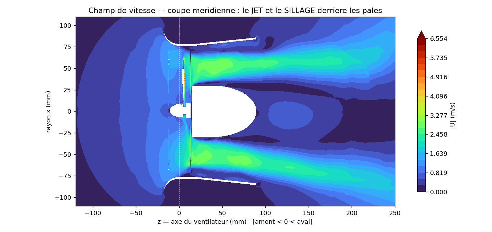
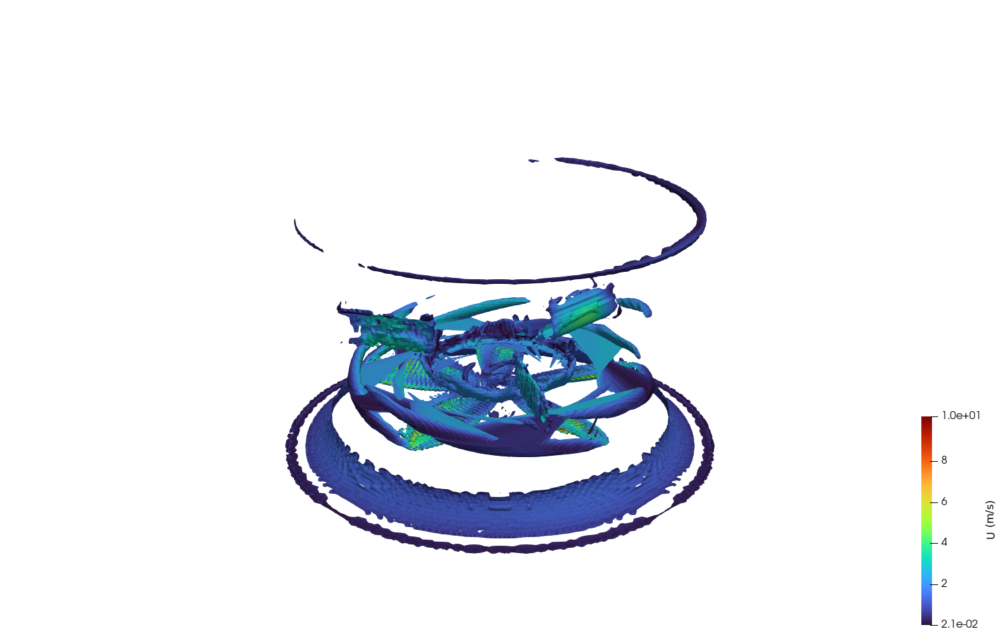
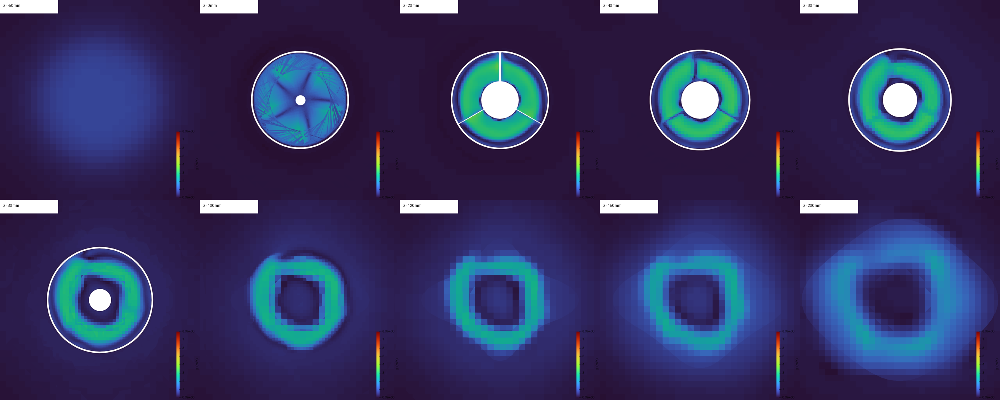
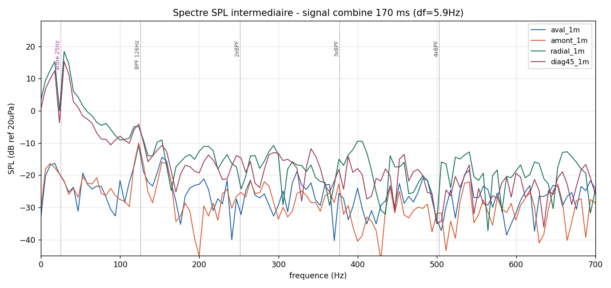

# Aeroacoustic CFD Study of a Ducted Fan with Bioinspired Blades

> End-to-end computational aeroacoustics (CAA) pipeline — from CAD geometry to the far-field noise
> spectrum — for a ducted desk fan whose blades carry **owl-feather-inspired trailing-edge
> serrations**. Unsteady **URANS k-ω SST** flow on a sliding-mesh (AMI) grid, coupled to the
> **Ffowcs-Williams & Hawkings** acoustic analogy.


-orange)


<p align="center">
  <br>
  <em>Vortical structures (Q-criterion) shedding from the rotating blades over one revolution — coloured by velocity.</em>
</p>

---

## 1. Overview

This project builds and runs a **complete numerical aeroacoustic workflow** to characterise the
tonal noise of a ducted fan, and applies it to a fan with **biomimetic (serrated) blades** inspired
by the silent flight of owls [1]. The chain couples an unsteady incompressible CFD simulation of the
rotating fan to an acoustic analogy that propagates the blade loading to virtual microphones at 1 m.

The full study is documented in the reports ([FR](docs/report_FR.pdf) · [EN](docs/report_EN.pdf)).
It is presented as an **exploratory engineering study**: the pipeline is operational and produces
physically consistent results, and the validation steps that remain are stated explicitly (§7).

**Why this project is interesting**
- A *complete* CAA chain (rare in student work): CAD → complex mesh → URANS → acoustic analogy → spectra.
- A **sliding-mesh (AMI)** treatment of true blade rotation — not a frozen-rotor / MRF shortcut.
- Deployed on a **self-built 2-node compute cluster** (MPI), with honest HPC benchmarking.
- **Scientific rigour**: mesh quality, y⁺, time-step strategy, FFT protocol and limitations are all reported.

---

## 2. Physical problem & methodology

Tonal fan noise originates from the **unsteady aerodynamic loading on the blades** (a rotating dipole
source). The workflow is:

```
   CAD geometry ──► Hex-dominant mesh (AMI) ──► URANS k-ω SST ──► FW-H analogy ──► 4 microphones @ 1 m
   (FreeCAD/STL)     (snappyHexMesh)            (pimpleFoam)       (Farassat 1A)     (SPL spectrum)
```

**Why an acoustic analogy?** The computational domain is only ~0.3 m across (microphones lie outside
it), and the incompressible solver carries no acoustic waves. The **Ffowcs-Williams & Hawkings**
analogy solves this: the unsteady loading is recorded on a surface enclosing the source (the blade
skin) and the wave equation is solved *analytically* to any far-field observer — no need to mesh out
to 1 m, no compressible solver.

**Two-phase time strategy** — the key methodological point:

| | Phase 1 — establish flow | Phase 2 — record sound |
|---|---|---|
| Time step | adaptive (`adjustTimeStep`, Co ≤ 5) | **fixed** Δt (uniform sampling for the FFT) |
| FW-H | off | **on** |
| Goal | statistically established regime | clean spectral analysis |

See [`docs/METHODOLOGY.md`](docs/METHODOLOGY.md) for the full derivation and settings.

---

## 3. Numerical setup

| Item | Value |
|---|---|
| Solver | `pimpleFoam` (incompressible, transient) |
| Turbulence | k-ω SST (URANS) |
| Rotation | solid-body, ω = 158 rad/s (≈ 1509 rpm), 5 ms startup ramp |
| Interface | sliding **cyclicAMI** (rotor ↔ static zone), built with `createBaffles` |
| Mesh | hex-dominant `snappyHexMesh`, **0.9 M (baseline) → 2.0 M (refined)** cells |
| Acoustics | FW-H, Farassat 1A (`libAcoustics`), 4 observers at 1 m |
| BPF | Z·n = 5 × 25.15 = **126 Hz** |

The runnable case configuration (dictionaries + initial fields) is in [`openfoam_case/`](openfoam_case/).

---

## 4. Aerodynamic results

<p align="center">
  
  <br>
  <em>Left: meridional velocity field — the annular jet and the hub wake. Right: 3-D Q-criterion vortices (tip vortices, helical wake).</em>
</p>

The flow is physically consistent with a ducted fan: an **annular jet** driven by the blades, a slow
**recirculating wake** behind the hub, blade-tip vortices and a helical wake. The wake development is
captured by transverse cuts downstream:

<p align="center">
  <br>
  <em>Wake development: transverse |U| cuts from z = −50 mm (upstream) to 200 mm (downstream). The 5-blade imprint dissipates into the jet.</em>
</p>

The bioinspired **serrated trailing edges** (the object of the study) are resolved by the mesh:

<p align="center">
  <br>
  <em>Close-up of the biomimetic serrations (owl-feather-inspired) along the blade trailing edges.</em>
</p>

**Established-regime performance** (integrated on the blades):

| Quantity | Value |
|---|---|
| Axial thrust | 43.3 mN |
| Torque | 1.02 mN·m |
| Aerodynamic power (Cω) | 0.162 W |
| Volume flow rate | ≈ 108 m³/h |
| Blade-tip speed (ωR) | 10.9 m/s |

---

## 5. Acoustic results

<p align="center">
  <br>
  <em>Far-field SPL spectrum at the 4 microphones (combined 0.20 s record, Δf ≈ 6 Hz).</em>
</p>

The FW-H analogy yields the pressure signal at each observer, from which the SPL spectrum is computed
(Hann window, single-sided, RMS-based OASPL — full protocol in the report). The spectrum shows a
**dominant low-frequency component (~25 Hz, once-per-revolution)** and an **identifiable blade-passing
tone (126 Hz)**, with higher levels in the radial/diagonal directions than on the axis.

| Microphone | 25 Hz (1/rev) | BPF 126 Hz | OASPL |
|---|---|---|---|
| downstream | −20 dB | −11 dB | −1 dB |
| upstream | −20 dB | −10 dB | −3 dB |
| radial | +18 dB | −5 dB | +21 dB |
| diag45 | +15 dB | −4 dB | +18 dB |

---

## 6. Key figures & media

| | |
|---|---|
| **Flow** | jet, vectors, pressure, Q-vortices, swirl, iso-Q levels, streamlines, wake cuts |
| **Acoustics** | signal, SPL spectrum, raw-vs-filtered, directivity, unsteady loads |
| **Mesh** | refinement transition (coarse far-field → fine rotor → very fine blade band) |
| **Animations** | fluid Q-vortices (1 rev), orbital views of vortices and blades — [`media/`](media/) |

---

## 7. Limitations & validations to carry out (scientific honesty)

This is an **exploratory study**. Stating the limits is part of the science:

1. **Mesh independence not established** — a 2.0 M-cell mesh was *retained*, not *validated* (≥3 meshes needed).
2. **Boundary layer under-resolved** — no prismatic layers, blade y⁺ ≈ 4 (avg) / 445 (max) → surface loading is preliminary.
3. **Time-step independence not verified** — a second Δt would confirm the BPF peak.
4. **URANS captures tonal noise only**, not broadband turbulence → absolute levels are underestimated.
5. **FW-H surface limited to the blades** (casing, arms, hub, quadrupoles excluded).
6. **Biomimetic effect not quantified** — a *smooth reference rotor* (same conditions) is required, and
   the serrations act mainly on broadband noise, which URANS does not resolve. **The spectrum is the
   *signature* of the biomimetic fan, not a *measurement of the serrations' effect*.**

The reports list a prioritised improvement plan (mesh/time-step convergence, resolved boundary layers,
longer recording, smooth reference rotor, LES/DES for broadband).

---

## 8. Reproducibility

```bash
# 1. CFD (OpenFOAM v2506+) — from openfoam_case/
blockMesh
surfaceFeatureExtract
snappyHexMesh -overwrite      # serial (parallel snappy crashes at load-balancing on AMI cases)
createBaffles -overwrite      # builds the cyclicAMI interface
decomposePar
mpirun -np 8 pimpleFoam -parallel      # Phase 1: establish; Phase 2: fixed Δt + FW-H (see controlDict)

# 2. Post-processing (Python 3 + numpy/scipy/matplotlib, ParaView pvpython)
python postprocessing/acoustics/post_acoustique_combine.py    # signal → SPL spectrum, BPF, OASPL
python postprocessing/aero/perf_aero.py                       # thrust/torque/power/flow rate
pvpython postprocessing/rendering/render_fluid.py             # flow visualisation frames → MP4
```

---

## 9. Repository structure

```
├── README.md
├── docs/                 Full reports (FR + EN, 11 p.) and detailed methodology
├── openfoam_case/        Runnable OpenFOAM configuration (dictionaries + initial fields)
├── postprocessing/       Python + pvpython scripts (acoustics, aero, rendering)
├── figures/              Curated flow / acoustics / mesh figures
├── media/                Animations (MP4 + GIF)
└── data/                 FW-H microphone signals + blade force histories
```

---

## 10. Tech stack

**OpenFOAM v2506** (pimpleFoam, snappyHexMesh, cyclicAMI) · **libAcoustics** (FW-H) ·
**Python** (numpy, scipy, matplotlib) · **ParaView / pvpython** · **FreeCAD** ·
**MPI** on a self-built 2-node Linux cluster.

## 11. Reference

[1] Z. Wei, S. Wang, S. Farris, N. Chennuri, N. Wang, S. Shinsato, K. Demir, M. Horii, **G. X. Gu**,
*Towards silent and efficient flight by combining bioinspired owl feather serrations with cicada wing
geometry*, **Nature Communications**, 2024 (Gu Research Group, UC Berkeley) — source of the acoustic
methodology and the biomimetic concept.

Key methods: Ffowcs Williams & Hawkings (1969) · Farassat Formulation 1A (NASA/TM-2007-214853) ·
Menter k-ω SST (AIAA J., 1994).

---

*Engineering student project (Polytechnia / Arts et Métiers – ENSAM). Reports available in French and English.*
