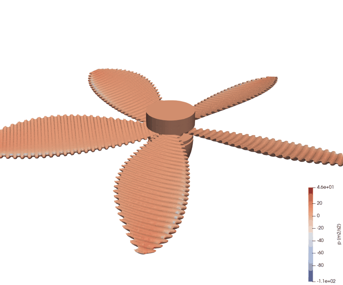
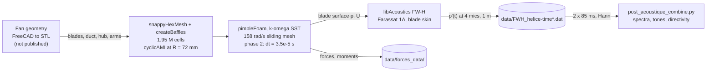
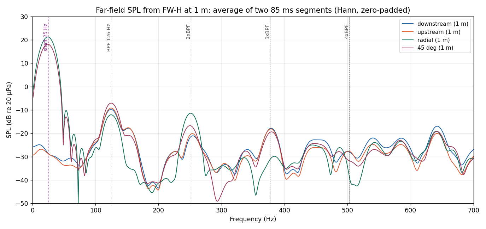

# Ducted-fan aeroacoustics: sliding-mesh URANS and Ffowcs Williams–Hawkings prediction of a serrated desk fan

A sliding-mesh URANS simulation (OpenFOAM, k-ω SST) of a 5-blade ducted desk fan with owl-inspired serrated blades, coupled to a Ffowcs Williams–Hawkings analogy, gives 43.3 mN of thrust at 1509 rpm and resolves the 126 Hz blade-passing tone 20 to 28 dB above the spectral floor at four microphones 1 m away.

[Report (PDF)](paper/main.pdf) · [Methodology](docs/METHODOLOGY.md) · [OpenFOAM case](openfoam_case/) · [Housing structure: ventilator-modal-analysis-petgcf](https://github.com/clementdumeril/ventilator-modal-analysis-petgcf) · [Cite](CITATION.cff)

<p align="center">
  <br>
  <em>Five serrated blades, colored by surface pressure (kinematic, m²/s²).</em>
</p>

## Overview

This was internal work at Polytechnia, the engineering consultancy I co-founded in 2026, on a quiet desk fan with trailing-edge serrations inspired by owl feathers (Wei et al., 2024). No client has received it. Between late May and June 2026 I built the chain from the FreeCAD model to the spectra, and in October 2026 I re-analysed the acoustic records and wrote the report. The structural side of the same fan (modes and impact of the PETG-CF housing) is in [ventilator-modal-analysis-petgcf](https://github.com/clementdumeril/ventilator-modal-analysis-petgcf).

Mine: STL preparation, meshing, the OpenFOAM case, the runs on a 2-node Linux cluster I set up (8 + 4 cores), the post-processing, the renders and the report. Reused: the fan geometry (Polytechnia FreeCAD model), OpenFOAM (ESI) and the FW-H implementation of [libAcoustics](https://github.com/unicfdlab/libAcoustics).



*Simulation chain and the committed files at each step. Forces are reduced by `postprocessing/aero/perf_aero.py`.*

## Formulation

**Flow model.** Incompressible URANS, `pimpleFoam`, air ρ = 1.2 kg/m³, ν = 1.5·10⁻⁵ m²/s, k-ω SST with automatic wall treatment (`omegaWallFunction`, `kqRWallFunction`). The rotor zone turns as a solid body at ω = 158 rad/s (1509 rpm, ramped from 0 over 5 ms) about +z, coupled to the stator through a cyclicAMI interface.

**Domain and boundary conditions.** Box of 0.4 x 0.4 x 0.5 m. Inlet, outlet and side faces are open: `totalPressure` p0 = 0 with `pressureInletOutletVelocity`. Blades are moving walls; duct, motor and arms are no-slip.

**Mesh.** Hex-dominant snappyHexMesh from a 10 mm background grid, blades refined to level 5 (0.31 mm) so the serrations are resolved. No prism layers: blade y⁺ averages about 4 and peaks at 445. The checkMesh figures are in [`docs/METHODOLOGY.md`](docs/METHODOLOGY.md#3-mesh).

**Time integration.** Euler implicit, PIMPLE with 3 outer and 2 inner correctors. Phase 1 (`system/controlDict`): adaptive Δt with maxCo 3.0 to 0.19 s. Phase 2 (`system/controlDict.phase2`): fixed Δt = 3.5·10⁻⁵ s to 0.39 s, so the FW-H signal is uniformly sampled.

**Acoustics.** Farassat formulation 1A on the rotating blade surface, c₀ = 343 m/s, no quadrupole term, no casing in the integration surface. Microphones at 1 m: downstream, upstream, radial, 45°. Each 100 ms record loses its first 15 ms; the two 85 ms segments are detrended, Hann-windowed, zero-padded to 8192 points (true resolution 11.8 Hz), and their power spectra averaged. The floor is the median level between 140 and 240 Hz.

## Results

| Quantity (ω = 158 rad/s) | Value | Source and check |
|---|---:|---|
| Axial thrust / torque / aerodynamic power | 43.3 mN / 1.02 mN·m / 0.162 W | `data/forces_data/`, `postprocessing/aero/perf_aero.py` (re-run, same values) |
| Volume flow rate, 60 mm downstream | 108 m³/h | report section 6.1; needs ParaView slices not in the repo |
| Blade-passing tone (BPF = 5 x 25.15 Hz) | 126 Hz, 20 to 28 dB above the floor on all four microphones | `data/FWH_helice-time*.dat`, `postprocessing/acoustics/post_acoustique_combine.py` (re-run) |
| Once-per-revolution tone | 25 Hz: 61 dB above the floor radially, 48 dB at 45°, at the floor on the axis | same script |

<p align="center">
  <br>
  <em>FW-H spectra relative to each microphone's floor. Shaded: a comb of lines spaced 100.5 Hz, probably numerical.</em>
</p>

The 25 Hz tone comes from the in-plane blade force, which rotates with the rotor, so it radiates in the rotor plane and not along the axis.

## Verification

| Check | Result | Source |
|---|---|---|
| FW-H against a compact-dipole estimate from the blade forces | mean load −9.1 dB, 25 Hz +13.7 dB, BPF −17.9 dB: absolute levels are not consistent, so only tone frequencies and directivity are used | `paper/scripts/dipole_check.py`, `paper/tables/dipole_check.tex` |
| High-frequency comb above 600 Hz | spacing locked to a quarter revolution (100.5 Hz), treated as numerical | `paper/scripts/comb_check.py` |
| Post-processing protocol | concatenating the two records put a 136° phase jump into the 25 Hz line, and a median filter raised the floor by 9 to 24 dB; both dropped | `figures/acoustics/raw_vs_filtered.png`, [`docs/METHODOLOGY.md`](docs/METHODOLOGY.md#5-acoustic-post-processing-fft-protocol) |
| Mesh and time-step independence | not done | |

## How to run

The STL geometry is not published, so only post-processing runs from this repo. Tested on Windows 10 with Python 3.11.9, NumPy 2.2.6, SciPy 1.15.2 and Matplotlib 3.10.6 (November 2026: both scripts reproduced the numbers above).

```bash
pip install -r requirements.txt
python postprocessing/acoustics/post_acoustique_combine.py   # ~8 s: tone table per microphone, spectra, directivity
python postprocessing/aero/perf_aero.py                      # ~7 s: "Thrust = 43.3 mN", torque, power
```

Both scripts overwrite the committed figures in `figures/` and `paper/figures/`.

With OpenFOAM ESI v2506 (used for the published records; the case dictionaries still carry v2406 headers from an earlier run), [libAcoustics](https://github.com/unicfdlab/libAcoustics) and the STL files in `constant/triSurface/`:

```bash
cd openfoam_case
cp -r 0.orig 0
blockMesh && surfaceFeatureExtract
snappyHexMesh -overwrite          # serial only
createBaffles -overwrite
decomposePar
export FOAM_SIGFPE=false
mpirun -np 8 pimpleFoam -parallel     # phase 1
cp system/controlDict.phase2 system/controlDict
mpirun -np 8 pimpleFoam -parallel     # phase 2, FW-H recording
```

## Reproducing figures

| Figure | Script |
|---|---|
| `figures/acoustics/*.png`, `paper/figures/spl_spectrum.pdf`, `directivity.pdf`, `raw_vs_filtered.pdf` | `postprocessing/acoustics/post_acoustique_combine.py` |
| `figures/acoustics/blade_loads_time.png`, `paper/figures/blade_loads_time.pdf` | `postprocessing/aero/perf_aero.py` |
| `paper/figures/comb_fold.pdf`, `paper/tables/dipole_check.tex` | `paper/scripts/comb_check.py`, `paper/scripts/dipole_check.py` |
| `figures/flow/*.png`, `media/*.gif` | `postprocessing/rendering/*.py` (ParaView pvpython; need the case results, not versioned) |

## Code structure

| Path | Content |
|---|---|
| `openfoam_case/` | `0.orig/` fields and BCs, `constant/` (rotation, turbulence), `system/` (mesh, schemes, solver, FW-H, both control dicts) |
| `data/` | FW-H pressure records at the four microphones, blade forces and moments |
| `postprocessing/acoustics/`, `postprocessing/aero/` | spectra and tone levels; thrust, torque, power |
| `postprocessing/rendering/` | ParaView render and animation scripts |
| `paper/` | report source, figure and table scripts, PDF |
| `docs/` | methodology and practical problems; June 2026 reports in `docs/archive/` (predate the re-analysis) |

## Limitations

- No mesh or time-step independence study, and no prism layers on the blades (y⁺ peaks at 445). The cluster that produced the published records is offline, so the link between those records and the 1.95 M-cell mesh could not be re-checked from the case directories (report section 4.1).
- URANS resolves tonal noise only, and there is no smooth-blade reference run, so this does not measure the effect of the serrations.
- Absolute levels disagree with the dipole estimate, so no OASPL or absolute dB is reported. Two 85 ms records give an 11.8 Hz resolution.
- No acoustic measurement; all results are numerical.

## Citation, license, credits

Cite with [`CITATION.cff`](CITATION.cff) or the report. MIT license, see [LICENSE](LICENSE).

- Serration concept: Z. Wei et al., *Nature Communications* 15, 2024, [doi:10.1038/s41467-024-48454-3](https://doi.org/10.1038/s41467-024-48454-3).
- FW-H: [libAcoustics](https://github.com/unicfdlab/libAcoustics). Solver: OpenFOAM (ESI).
- Fan geometry: Polytechnia FreeCAD model. Simulation setup, runs, post-processing and report: Clément Dumeril.

Clément Dumeril · [clement.dumeril.net](https://clement.dumeril.net) · [github.com/clementdumeril](https://github.com/clementdumeril)
